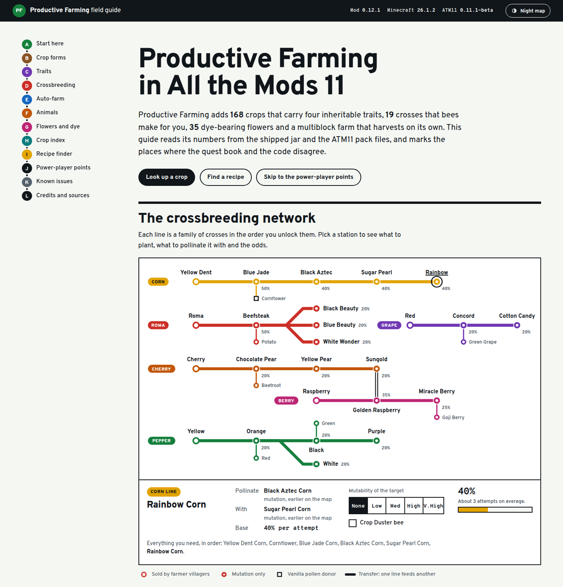

# Productive Farming field guide for All the Mods 11

**Read it here: https://targetedentropy.github.io/productive-farming-guide/**

[](https://targetedentropy.github.io/productive-farming-guide/)

An unofficial, fan-made reference for the [Productive Farming](https://www.curseforge.com/minecraft/mc-mods/productivefarming) mod as it ships in the [All the Mods 11](https://www.curseforge.com/minecraft/modpacks/all-the-mods-11) modpack. Every number on the page is read from the mod's jar and the pack's files, and the guide says so where the in-game quest book and the code disagree.

| Covers | Version |
| --- | --- |
| Productive Farming | 26.1.2-0.12.1 |
| All the Mods 11 | 0.11.1-beta |
| Minecraft / loader | 26.1.2, NeoForge |

## What is in the guide

- **The crossbreeding network.** All 19 mutations drawn as a transit map. Pick a station to see the target crop, the pollen donor and the odds, with a calculator for the Mutability trait and the Crop Duster bee.
- **Crop index.** 172 crops, searchable by name or Latin name and filterable by growth form and source, with villager trade level, price, planter output, food value and storage blocks.
- **Recipe finder.** 495 entries in one searchable list: crafting, smoking, crosses, farmer trades, AgriTech: Evolved planter outputs, crates and seed bags.
- **How it works.** Crop forms, the four traits and their exact maths, bee pollination, the Farm Controller multiblock, fish farms and Nutrient Water, troughs, flowers and dye blending.
- **Power-player points** and a list of **known upstream issues** with links.

## Credit where it is due

This site hosts no part of the mod. Please get the real thing from its authors:

| Project | By | Links |
| --- | --- | --- |
| Productive Farming | LobsterJonn (JDKDigital) | [CurseForge](https://www.curseforge.com/minecraft/mc-mods/productivefarming) · [source](https://github.com/JDKDigital/productivefarming) · [issues](https://github.com/JDKDigital/productivefarming/issues) |
| All the Mods 11 | ATM Team | [CurseForge](https://www.curseforge.com/minecraft/modpacks/all-the-mods-11) · [repository](https://github.com/AllTheMods/ATM-11) |
| Productive Bees | LobsterJonn | [CurseForge](https://www.curseforge.com/minecraft/mc-mods/productivebees) |
| Productive Trees | LobsterJonn | [CurseForge](https://www.curseforge.com/minecraft/mc-mods/productivetrees) |
| Dyenamics | LobsterJonn | [CurseForge](https://www.curseforge.com/minecraft/mc-mods/dyenamics) |
| Mystical Agriculture | BlakeBr0 | [CurseForge](https://www.curseforge.com/minecraft/mc-mods/mystical-agriculture) |
| AgriTech: Evolved | misterdmodding | [CurseForge](https://www.curseforge.com/minecraft/mc-mods/agritech-evolved) |
| Croptopia | thethonk | [CurseForge](https://www.curseforge.com/minecraft/mc-mods/croptopia) |
| Silent Gear | SilentChaos512 | [CurseForge](https://www.curseforge.com/minecraft/mc-mods/silent-gear) |
| BBL Strainers | benbenlaw | [CurseForge](https://www.curseforge.com/minecraft/mc-mods/opolis-strainers) |
| Jade | Snownee | [CurseForge](https://www.curseforge.com/minecraft/mc-mods/jade) |
| Just Enough Items | mezz | [CurseForge](https://www.curseforge.com/minecraft/mc-mods/jei) |
| Overpass, Overpass Mono | The Overpass Project Authors | [SIL OFL 1.1](assets/fonts/OFL.txt) |

Productive Farming is All Rights Reserved by its author. This repository contains none of its textures, models or code. It contains names and numbers (crop names, trade prices, recipe ingredients, chances) and one colour per crop, averaged from the item icon. Not affiliated with or endorsed by LobsterJonn, the ATM Team, CurseForge, Mojang or Microsoft.

## How the data was gathered

1. The pack manifest names the exact Productive Farming file ATM11 uses. That jar and the pack archive were downloaded from CurseForge.
2. `tools/build_data.py` reads the unpacked jar (language file, recipes, villager trades, tags, data maps), one file of the mod's public source for crop groupings and flower colours, and the pack manifest, then writes `assets/data.js`.
3. Mechanics in the prose (trait maths, controller timing, pollination range and so on) were read from the mod's source at branch `dev-26.1` and checked against its issue tracker.
4. The pack's `config` and `kubejs` folders were searched for overrides. ATM11 touches the mod in two places: a quest chapter, which was read for comparison, and a BBL Strainers setting that keeps the 19 cross-only crops out of that mod's Seed Bag.

Nothing here was play-tested. If the game disagrees with the guide, the game is right; please [open an issue](https://github.com/TargetedEntropy/productive-farming-guide/issues).

### Rebuilding the dataset for a new version

```sh
# unpack the mod jar and the pack zip yourself, and clone the mod's source
python3 tools/build_data.py path/to/unpacked-jar path/to/productivefarming-source path/to/unpacked-pack assets/data.js
```

The script needs only the Python standard library. The mod jar, the pack archive and any API keys stay out of the repository; `.gitignore` covers them.

## Running it locally

There is no build step. Serve the folder with anything:

```sh
python3 -m http.server 8000
```

| Path | What it is |
| --- | --- |
| `index.html` | All written content |
| `assets/styles.css` | The design: a transit-map and signage system, light and dark |
| `assets/app.js` | Draws the map, tables, crop index and recipe finder |
| `assets/data.js` | Generated dataset |
| `tools/build_data.py` | Dataset generator |
| `PRODUCT.md`, `DESIGN.md` | Product and design notes |

## Licence

Site code and prose: [MIT](LICENSE). Fonts: SIL Open Font License 1.1. Everything belonging to the mods and the pack remains with its authors.
